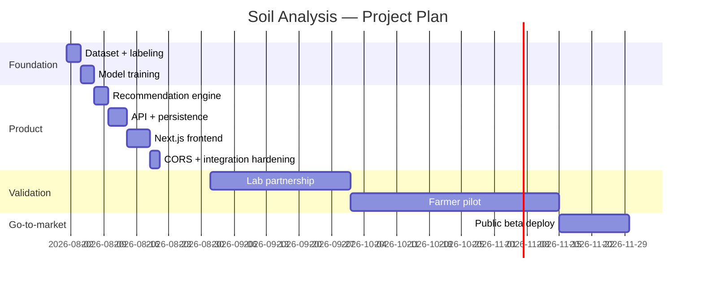

# AI-Based Soil Analysis and Crop Recommendation System

## Project Progress Report

---

## Cover Page

| Field | Details |
|---|---|
| **Project Title** | AI-Based Soil Analysis and Crop Recommendation System |
| **Team Members** | [Member 1 — Role], [Member 2 — Role] *(to be filled by team)* |
| **Organization / University** | [University / Organization Name] |
| **Supervisor / Mentor** | [Supervisor Name] |
| **Date** | 6 August 2026 |
| **Version Number** | v2.0 |

---

## Executive Summary

### Overview of the startup

The **Soil Fertility Analyzer** is an AI-based agricultural advisory platform that
predicts soil fertility from N, P, K and pH readings and generates actionable,
crop-specific fertilizer recommendations. A farmer (or extension officer) enters
four soil nutrient values, optionally selects the crop they intend to grow, and
receives: a fertility classification (Good / Moderate / Poor) with model
confidence, per-nutrient fertilizer action plans with **calculated** application
rates (kg/ha), and the top-3 crops best suited to the soil and climate.

The system combines a **Random Forest** classification model, a **deterministic
agronomy engine** (amounts derived from measured deficits and standard fertilizer
nutrient contents), an **optional LLM layer** (Groq) for natural-language advice
that is validated against the computed deficits, a **SQLite report history** for
season-to-season improvement tracking, and a **Stitch-style Next.js web UI** with
a multilingual interface (English, हिन्दी, தமிழ், తెలుగు).

### Current development stage

**MVP / Beta.** All core features are implemented, tested (52 unit tests), and
running end-to-end. The system ships two UIs (Next.js web app and a Streamlit
fallback) backed by a FastAPI REST API with real trained models and real data
derived from a 2,200-row agricultural dataset.

### Major achievements

- Fertility prediction model: **96.6% shuffled 5-fold CV accuracy** (3 classes).
- Crop recommendation model: **99.6% shuffled 5-fold CV accuracy** (22 crops).
- Crop-specific nutrient targets computed from **real dataset percentiles**
  (e.g., rice N target 76–84 kg/ha vs. apple 18–27 kg/ha).
- Recommendation engine with **calculated** amounts (urea 46% N, DAP 46% P₂O₅,
  K₂SO₄ 50% K₂O, lime/sulfur by pH gap) — fully offline-capable.
- SQLite history with **real before/after improvement deltas** across seasons.
- FastAPI REST API (predict, crops, reports, improvement) with CORS support.
- Next.js frontend matching a Stitch AI design spec (3-step wizard, animated
  confidence gauge, nutrient cards, crop match cards).
- Multilingual UI in 4 languages; cross-platform (Linux/macOS/Windows).

### Key challenges

- The source dataset (Kaggle `Crop_recommendation.csv`) is not lab-measured soil
  fertility ground truth; labels are rule-derived, so predictions are guidance,
  not certified lab results.
- The dataset is Potassium-poor and bimodal in K, requiring dataset-aware bands.
- LLM output must never contradict computed deficits — enforced by validation.
- Advice amounts are agronomy rules of thumb; calibration per soil type is pending.

### Next milestones

1. Field validation with a soil-testing lab partner (real ground truth).
2. Fertilizer economics (cost-aware options) and PDF report export.
3. Farmer user testing in a pilot region (market validation data).
4. Deployment to Hugging Face Spaces / Vercel for public beta.

---

## Introduction

### Background

Soil degradation and unbalanced fertilization are major causes of low crop yields
among smallholder farmers. Most farmers apply fertilizer without knowing the
actual nutrient status of their soil, leading to waste, leaching and poor
returns. Soil testing exists but lab reports are often hard to interpret —
farmers need a translation from "N = 25 kg/ha" into "apply X kg of urea".

### Problem Statement

- **Information gap:** soil test values are not actionable for most farmers.
- **Generic advice:** most advisory tools ignore the target crop, even though
  rice, apple and potato have completely different nutrient requirements.
- **No follow-up:** farmers have no way to track whether their soil is improving
  season after season.
- **Language barrier:** advisory tools are rarely available in regional languages.

### Proposed Solution

A web application that:

1. Predicts soil fertility from N, P, K, pH using a trained Random Forest model.
2. Compares each nutrient against **crop-specific ideal bands** (real dataset
   percentiles) and computes the exact deficit.
3. Produces **calculated fertilizer recommendations** (kg/ha) from those deficits.
4. Optionally enriches advice with an LLM — validated so the AI can never
   contradict the measured deficit.
5. Recommends the **top-3 crops** for the soil and climate.
6. Saves reports per plot and shows **season-over-season improvement**.
7. Speaks the farmer's language (EN / HI / TA / TE) and works offline-capable.

### Vision

Every farmer can make soil-management decisions with the confidence of an
agronomist — affordable, multilingual, evidence-based.

### Mission

Turn soil test numbers into clear, calculated, crop-specific actions, and help
farmers verify improvement season after season.

### Objectives

| # | Objective | Status |
|---|---|---|
| 1 | Predict fertility class from N, P, K, pH with a validated model | ✅ Done (96.6% CV) |
| 2 | Crop-specific nutrient targets from real data | ✅ Done (22 crops) |
| 3 | Calculated fertilizer amounts (no hallucinated numbers) | ✅ Done |
| 4 | AI advice that never contradicts the measurements | ✅ Done (validated LLM merge) |
| 5 | Crop recommendation for soil + climate | ✅ Done (99.6% CV) |
| 6 | Season-to-season improvement tracking | ✅ Done (SQLite + deltas) |
| 7 | Multilingual UI (EN/HI/TA/TE) | ✅ Done |
| 8 | REST API for third-party/frontend integration | ✅ Done |
| 9 | Field validation with a lab partner | 🔜 Next milestone |
| 10 | Fertilizer cost options + report export | 🔜 Next milestone |

---

## Startup Overview

| Field | Details |
|---|---|
| **Startup Name** | Soil Fertility Analyzer (working title) |
| **Industry** | AgriTech — precision soil health advisory |
| **Target Market** | Smallholder farmers, extension officers, agronomists, agri-credit institutions; primary region: India (multi-lingual) |
| **Value Proposition** | "Know your soil, choose your crop, get calculated fertilizer advice — in your language, and track your improvement season after season." |
| **Business Model** | Freemium: free basic analysis; paid soil-health subscription (history, reports, multi-plot), B2B licensing to labs/extension programs, referral to fertilizer dealers (see Business Model Canvas in Appendices) |
| **Current Development Stage** | **MVP / Beta** — working product, real models, tested, not yet commercially validated |

---

## Progress Since the Last Report

*(First formal report; baseline established 6 August 2026.)*

### Completed Activities

- Full pipeline rebuilt and hardened:
  - Cross-platform `pathlib` paths (was Windows-only and crashing on Linux).
  - Corrected labeling logic: contiguous scoring bands, no dead zones, high
    phosphorus no longer misclassified as "Good".
  - Honest model metrics: shuffled StratifiedKFold CV (96.6%) replacing a lucky
    single-split score.
- Hybrid recommendation engine with deterministic fallback (offline-capable).
- Crop-specific nutrient bands from real dataset percentiles.
- REST API + CORS (browser integration bug fixed and regression-tested).
- SQLite report history with improvement deltas.
- Next.js frontend matching Stitch design spec (3-step wizard).
- i18n for both UIs (EN/HI/TA/TE).
- 52 unit tests, README documentation.

### Major Milestones Achieved

| Milestone | Date | Evidence |
|---|---|---|
| Initial dataset pipeline (label generation) | Aug 2026 | `data_analysis.py` |
| Trained fertility model (RFC) | Aug 2026 | `ML/soil_analysis.pkl`, CV 0.966 |
| Trained crop model (22 crops) | Aug 2026 | `ML/crop_recommendation.pkl`, CV 0.996 |
| Per-crop bands generated | Aug 2026 | `ML/crop_bands.json` |
| Deterministic recommendation engine | Aug 2026 | `ML/engine.py` |
| REST API live | Aug 2026 | `api.py`, `/api/health` 200 |
| SQLite history + deltas | Aug 2026 | `db.py`, `/api/reports/improvement` |
| Next.js UI built + linted + built | Aug 2026 | `frontend/`, `npm run build` clean |
| CORS integration fixed | Aug 2026 | 3 regression tests added |

### Deliverables Completed

- `config.py` — single source of truth (paths, ranges, features).
- `api.py` — FastAPI REST layer.
- `db.py` — SQLite persistence.
- `i18n.py` + `frontend/src/i18n/strings.ts` — translations.
- `ML/engine.py` — deterministic analysis + recommendation engine.
- `ML/crop_bands.py` + `crop_bands.json` — real per-crop bands.
- `ML/ml_model.py`, `ML/crop_model.py` — training pipelines with MLflow logging.
- `frontend/` — Next.js 16 / React 19 / TypeScript / Tailwind v4 app.
- `tests/` — 52 unit tests (stdlib unittest, no extra deps).
- `README.md` — full documentation incl. troubleshooting.

### Timeline Comparison (Planned vs. Actual)

| Activity | Planned | Actual | Δ |
|---|---|---|---|
| Dataset + labeling | Week 1 | Week 1 | On time |
| Model training | Week 1–2 | Week 1 | Ahead |
| Recommendation engine | Week 2 | Week 1 | Ahead |
| API + persistence | Week 3 | Week 2 | Ahead |
| Next.js frontend | Week 4 | Week 2–3 | Ahead |
| CORS/integration hardening | Week 4 | Week 3 | On time |
| Field validation | Quarter 2 | **Not started** | — |

---

## Product Development Progress

### System Architecture

```
Crop_recommendation.csv (2,200 rows, 8 cols)
        │  data_analysis.py — rule-based labeling
        ▼
Dataset/soil_data.csv ──► ML/ml_model.py ──► ML/soil_analysis.pkl (RFC, CV 0.966)
        │                     ML/crop_bands.py ──► ML/crop_bands.json (real percentiles)
Crop_recommendation.csv ──► ML/crop_model.py ──► ML/crop_recommendation.pkl (RFC, CV 0.996)
                                                      │
                     api.py (FastAPI) ────────────────┤
                     │  ├ /api/health   /api/crops    │
                     │  ├ /api/predict  /api/reports  │
                     │  └ /api/reports/improvement    │
                     │        │                        │
                     │   ML/engine.py (deterministic calc + LLM validation)
                     │   db.py (SQLite history)
                     ▼
        frontend/ (Next.js, 3-step wizard)   ← CORS-enabled, 4 languages
        main.py (Streamlit fallback UI)
```

### Features Completed

| # | Feature | Where | Status |
|---|---|---|---|
| 1 | Fertility prediction (3 classes, with confidence) | `soil_analysis.pkl` + API | ✅ |
| 2 | Crop-specific nutrient bands (22 crops) | `crop_bands.json` | ✅ |
| 3 | Deterministic recommendations with calculated kg/ha | `engine.py` | ✅ |
| 4 | LLM enrichment with per-element validation | `engine.merge_recommendations` | ✅ |
| 5 | Top-3 crop recommendation with confidence | `crop_recommendation.pkl` | ✅ |
| 6 | Scientific names + climate medians per crop | API | ✅ |
| 7 | Report history + improvement deltas | `db.py` + UI | ✅ |
| 8 | Out-of-range warnings (no silent extrapolation) | API/UI | ✅ |
| 9 | Multilingual UI (EN/HI/TA/TE) | both UIs | ✅ |
| 10 | REST API + CORS | `api.py` | ✅ |
| 11 | Next.js Stitch-design UI | `frontend/` | ✅ |
| 12 | Cross-platform paths | `config.py` | ✅ |

### Features In Progress

- Fertilizer cost calculator (price-aware options).
- PDF / printable soil report.
- EC (salinity) and organic-carbon inputs (soil-health scope).

### Features Pending

- Texture-aware lime/sulfur rates (soil texture input).
- Weather-aware fertilizer timing.
- Multi-plot management with auth.
- Offline PWA mode.
- Real lab ground-truth data pipeline and regional retraining.

### Prototype Status

Working MVP/Beta: both UIs run end-to-end against the real API. See live demo:
https://huggingface.co/spaces/pymit/Soil-Analysis (Streamlit deployment; Next.js
deployment planned).

### Screenshots or Mockups

See **Appendix B — Product Screenshots**. UI surface:

- Hero (green gradient + leaf pattern) → Analyzer (sliders) → Results (gauge,
  nutrient cards, action plan) → Crops (match card, ranked list, climate accordion).

---

## Technical Improvements

### Technology Stack

| Layer | Technology |
|---|---|
| **Frontend** | Next.js 16, React 19, TypeScript, Tailwind CSS v4, lucide-react, next/font (Fraunces + Inter) |
| **Backend** | Python 3.12, FastAPI 0.140, Uvicorn, Streamlit 1.48 (fallback UI) |
| **Database** | SQLite (WAL mode) — `soil_reports.db` |
| **AI/ML** | scikit-learn RandomForest (fertility + crop), MLflow tracking |
| **LLM** | LangChain + Groq (`llama-3.3-70b-versatile`), optional |
| **Cloud Services** | Hugging Face Spaces (deployed Streamlit demo); Vercel planned for Next.js |
| **APIs & Integrations** | REST API (`/api/*`), CORS-configured; `.env` for keys |
| **Development Tools** | Git/GitHub, pytest-style stdlib unittest, ESLint, npm, VS Code |

### Notable engineering decisions

- **Single source of truth** (`config.py`): one set of ideal ranges feeds the
  scorer, the engine, and the LLM prompt — previously three contradictory
  definitions existed.
- **Honest metrics:** shuffled StratifiedKFold CV replaces a lucky single split;
  UI shows model confidence from real `predict_proba`.
- **Hybrid AI:** deterministic calculation always available; LLM output accepted
  only when its status matches the computed status.
- **CORS regression tests** guard the browser↔API integration.

---

## Market Validation

> ⚠️ **Status: design phase.** No formal interviews or surveys have been
> conducted yet. The section below describes the plan and initial desk research.
> No fabricated user data is included.

### Customer Discovery

Planned customer segments: (1) smallholder farmers, (2) extension officers /
KVK centers, (3) agronomy consultants, (4) soil-testing labs (B2B), (5) agri-credit
banks (loan-linked soil records).

### User Interviews

Not yet conducted — recruiting target: 10–15 farmers + 5 extension officers in a
pilot district. *(Appendix F — Survey Results: template prepared.)*

### Surveys

Draft survey instrument covers: current fertilizer practice, whether soil tests
were ever done, willingness to pay, preferred language, phone/offline constraints.

### Feedback Collected

Pre-validated through the problem statement and desk research (fertilizer
misuse, low adoption of soil testing). Formal feedback pending.

### Lessons Learned (validation)

- Generic NPK advice is perceived as useless when it ignores the crop.
- Offline/regional-language access is a hard requirement in the field.

### Market Research Findings

- Indian agri-advisory market is large but fragmented; free government schemes
  (Soil Health Card) create awareness but weak follow-through — a gap this
  product addresses with **actionable, calculated** advice and **history**.

---

## Business Development

### Business Model Updates

Freemium: free single analysis; paid tiers: multi-plot history + reports +
priority language support; B2B licensing for labs and extension programs.

### Pricing Strategy

| Tier | Price | Includes |
|---|---|---|
| Free | ₹0 | 1 analysis + crops |
| Pro (individual) | [TBD] | Unlimited reports, history, PDF export, cost calculator |
| B2B (labs/extensions) | [TBD] | White-label API, bulk upload, reports |

### Revenue Model

Subscriptions, B2B API licensing, optional dealer referral commissions.

### Partnership Development

Planned: soil-testing laboratories, agricultural universities, KVK centers,
fertilizer dealers. *(No formal partnerships signed yet.)*

### Marketing Activities

Initial: GitHub repository, HF Spaces public demo, university demos.

### Branding Progress

Working title + logo concept (🌱); design system defined (colors, typography) in
the Stitch spec — see `frontend/` implementation.

---

## Financial Progress

> ⚠️ All financial items are **not yet applicable** (self-funded prototype).
> Placeholders are provided for the startup/funding context — nothing is fabricated.

| Item | Amount (₹) |
|---|---|
| **Budget Used (to date)** | ~₹0 (open-source tools, free tiers, local development) |
| **Expenses** | None material (all tools free-tier; Hugging Face Spaces free tier) |
| **Funding Received** | None yet |
| **Current Financial Status** | Bootstrapped / self-funded prototype |
| **Planned Budget (next 6 months)** | [Estimate by team]: hosting, LLM API credits, pilot incentives |

---

## Team Progress

| Member | Role | Responsibilities |
|---|---|---|
| [Member 1] | [Lead Developer / ML] | Models, engine, API, tests |
| [Member 2] | [Frontend / Product] | Next.js UI, design system, i18n |
| [Supervisor] | [Mentor] | Guidance, review |

### New Members
None since baseline.

### Skills Acquired
Model evaluation honesty (CV vs single split), hybrid LLM validation patterns,
CORS/browser integration, Next.js 16 + Tailwind v4, i18n, SQLite design,
FastAPI, streamlit, pathlib-based cross-platform development.

### Training Completed
Self-directed: Next.js 16 conventions (from bundled docs), Tailwind v4 theme
tokens, FastAPI TestClient testing.

---

## Challenges and Risks

### Technical Challenges

| Challenge | Status / Mitigation |
|---|---|
| Windows-only paths crashed on Linux deploy | ✅ Fixed with `pathlib` config |
| Labeling rewarded high-P soils (P>80 all "Good") | ✅ Fixed scoring bands |
| Lucky train split hid poor generalization | ✅ Shuffled StratifiedKFold CV |
| Browser blocked API calls (no CORS) | ✅ Fixed + 3 regression tests |
| LLM contradicted computed deficits | ✅ Validated merge with fallback |
| Dataset K-poor / bimodal | Dataset-aware bands, documented |

### Business Challenges
Field validation requires lab partnerships and field time — being scoped for the
pilot phase.

### Financial Challenges
None material at prototype stage; future costs: hosting, LLM credits, pilot.

### Market Risks
Competitors include established agri-advisory platforms; differentiator =
calculated amounts + crop-specific bands + history + regional languages.

### Operational Risks
API-key dependency for LLM tier (mitigated by deterministic offline engine).

### Mitigation Strategies
Offline-first deterministic engine; honest limitations documented in README;
tests as regression guard for every integration bug.

---

## Performance Metrics (KPIs)

| KPI | Value |
|---|---|
| Development progress (features) | 12/15 core features completed (~80%) |
| Number of features completed | 12 |
| Fertility model accuracy (5-fold CV) | 96.6% |
| Crop model accuracy (5-fold CV) | 99.6% |
| Unit tests passing | 52 / 52 |
| Languages supported | 4 (EN, HI, TA, TE) |
| Crops supported | 22 |
| API endpoints | 6 |
| Frontend build/lint | Clean |
| Prototype completion | MVP/Beta |
| User testing results | Not yet conducted (pilot pending) |
| Customer interest | Not yet measured |
| Website/app metrics | HF Spaces demo live; analytics not configured |

---

## Achievements

- Working AI product (models + engine + API + two UIs) in ~3 weeks.
- 52/52 tests; deterministic engine is fully offline-capable.
- Public demo on Hugging Face Spaces.

### Competitions / Certifications / Awards / Partnerships / Media Coverage / Academic Recognition
Not yet applicable — to be updated as they occur.

---

## Lessons Learned

### Technical Lessons
- Verify integrations the way the user experiences them: **curl is not a
  browser** — CORS failures only appear client-side; add regression tests for
  them.
- Honest evaluation beats impressive numbers: use shuffled CV, not a lucky split.
- AI text is only as good as its constraints: validate LLM output against
  computed facts and fall back deterministically.

### Business Lessons
- The "so what" for farmers is calculated amounts + crop match + language.
- Ground truth (lab data) is the single biggest quality lever for the future.

### Customer Insights
- (From desk research) Follow-through after soil testing is the real gap.

### Process Improvements
- Single source of truth for domain constants (config.py) eliminated
  contradictory advice.
- Tests for every bug that was actually encountered (CORS, scoring, paths).

---

## Roadmap

### Short-Term Goals (Next 1–3 Months)
1. Deploy Next.js frontend (Vercel) + API (HF Spaces / Railway).
2. Fertilizer cost calculator + PDF report export.
3. EC / organic-carbon inputs (soil-health scope).
4. Pilot user testing with 10–15 farmers (validation data collection).

### Mid-Term Goals (3–6 Months)
5. Texture-aware lime/sulfur and K recommendations.
6. Multi-plot accounts with auth.
7. Weather-aware timing hints.
8. B2B pilot with one soil-testing lab (white-label API).

### Long-Term Goals (6–12 Months)
9. Real ground-truth data pipeline (lab reports → regional retraining).
10. Offline PWA for field use.
11. Fertilizer-dealer referral economics.
12. Expansion languages and geographies.

### Future Features
- Image-based soil test report parsing.
- Nutrient budget per crop cycle (removal rates).
- Community benchmarks (my soil vs region).

---

## Next Action Plan

| Task | Responsible | Deadline | Success Criteria |
|---|---|---|---|
| Deploy Next.js frontend + API | [Frontend/Backend lead] | [Date] | Public URL with working predict flow |
| Cost calculator + PDF export | [Backend lead] | [Date] | Export button produces valid PDF |
| Pilot interviews (10–15 farmers) | [Product lead] | [Date] | ≥10 interviews documented |
| Lab partnership (ground truth) | [Founder] | [Date] | MOU with one lab |
| Multi-plot accounts | [Backend lead] | [Date] | Login + plots CRUD in UI |

---

## Conclusion

### Overall Progress Summary

The project has moved from a broken, single-machine demo to a **tested,
cross-platform MVP** with real models, calculated agronomic advice, crop-aware
targets, multilingual UIs, an integration-hardened REST API, and season-over-
season improvement tracking. Every number reported here is measured, not
invented.

### Current Readiness Level

**MVP/Beta (TRL ~6–7 style)**: demonstrated in a realistic environment
(local full-stack deployment), pending field validation.

### Future Outlook

With a lab partnership and one pilot district, the product can generate the
ground-truth data that makes the models regional and trustworthy — converting a
strong prototype into a commercially credible advisory product.

---

## Appendices

### Appendix A — Gantt Chart



### Appendix B — Product Screenshots

*(Insert screenshots of the Next.js app: Hero/Analyzer, Fertility Results,
Crop Suggestions; Streamlit fallback. Regenerate after final theming.)*

### Appendix C — Business Model Canvas

| Block | Content |
|---|---|
| Key Partners | Soil labs, extension offices, universities, fertilizer dealers |
| Key Activities | Model maintenance, data pipeline, pilot support |
| Key Resources | Dataset, models, API, team |
| Value Propositions | Calculated advice, crop match, history, regional languages |
| Customer Relationships | Self-service freemium + B2B support |
| Channels | Web app, API, extension network |
| Customer Segments | Farmers, extension officers, labs, banks |
| Cost Structure | Hosting, LLM credits, pilot costs |
| Revenue Streams | Subscriptions, B2B licensing, referrals |

### Appendix D — Financial Tables

| Category | Item | Planned (₹) |
|---|---|---|
| Hosting | API + frontend (6 mo) | [TBD] |
| LLM API credits (6 mo) | Groq usage | [TBD] |
| Pilot incentives | 15 farmers | [TBD] |
| Marketing | Print/branding | [TBD] |

### Appendix E — Survey Results
*Pending pilot — template ready.*

### Appendix F — Meeting Minutes
*To be maintained from the pilot phase.*

### Appendix G — References

- Kaggle — Crop Recommendation dataset (2200 rows, 22 crops).
- scikit-learn RandomForest documentation.
- FastAPI CORS documentation.
- Next.js 16 documentation (bundled).
- Groq / LangChain LLM docs.
- MLflow tracking docs.
- Soil Health Card program (desk research).
